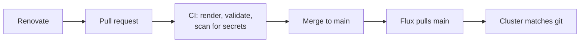

<div align="center">

# home-ops

_My home Kubernetes cluster, run as code:_
_[Talos Linux](https://www.talos.dev) on six mini PCs, deployed by [Flux](https://fluxcd.io), kept current by [Renovate](https://github.com/renovatebot/renovate)_

[](https://talos.dev)&nbsp;&nbsp; [](https://kubernetes.io)&nbsp;&nbsp; [](https://fluxcd.io)&nbsp;&nbsp;


[](https://github.com/home-operations/kromgo)&nbsp;&nbsp; [](https://github.com/home-operations/kromgo)&nbsp;&nbsp; [](https://github.com/home-operations/kromgo)&nbsp;&nbsp; [](https://github.com/home-operations/kromgo)&nbsp;&nbsp; [](https://github.com/home-operations/kromgo)&nbsp;&nbsp; [](https://github.com/home-operations/kromgo)&nbsp;&nbsp; [](https://github.com/home-operations/kromgo)

</div>

> [!NOTE]
> **Rebuild in progress.** This repository replaces an earlier setup that was managed through a
> hosted control plane. Sections marked _(planned)_ describe what is being built and are not live
> yet. The status line below is updated as each stage lands.
>
> **Stage:** repository skeleton and tooling ✅ · Talos configs ✅ · bootstrap and core apps ⏳ ·
> cluster rebuild ⏳ · backups proven ⏳ · apps migrated ⏳

## Overview

This repository is the single source of truth for my home Kubernetes cluster. Everything from the
operating system configuration to the applications is declared here; nothing is configured by hand
on the nodes.

- **Infrastructure as code**: the Talos machine configuration for every node is rendered from the
  templates in [`talos/`](talos).
- **GitOps**: Flux watches the `main` branch and makes the cluster match
  [`kubernetes/`](kubernetes). A change is a pull request; merging it deploys it.
- **Automated updates**: Renovate opens pull requests for new versions of charts, images, tools,
  Talos and Kubernetes. CI renders and validates every pull request before it can merge.
- **No secrets in git**: not even encrypted ones. Secrets live in a secret manager and are pulled
  in at deploy time.

The layout and patterns follow [onedr0p/home-ops](https://github.com/onedr0p/home-ops) and the
[home-operations](https://github.com/home-operations) community.

## Hardware

Six **HP ProDesk 405 G4 Desktop Mini** PCs in a small rack, behind one managed gigabit switch.

| Node      | Role          | CPU                              | RAM   | OS disk     | Data disk       |
| --------- | ------------- | -------------------------------- | ----- | ----------- | --------------- |
| `talos-1` | Control plane | AMD Ryzen 5 PRO 2400GE (4c / 8t) | 32 GB | 256 GB NVMe | 1 TB SATA SSD   |
| `talos-2` | Control plane | AMD Ryzen 5 PRO 2400GE (4c / 8t) | 32 GB | 256 GB NVMe | 960 GB SATA SSD |
| `talos-3` | Control plane | AMD Ryzen 5 PRO 2400GE (4c / 8t) | 32 GB | 256 GB NVMe | 960 GB SATA SSD |
| `talos-4` | Worker        | AMD Ryzen 5 PRO 2400GE (4c / 8t) | 16 GB | 256 GB NVMe | 1 TB SATA SSD   |
| `talos-5` | Worker        | AMD Ryzen 5 PRO 2400GE (4c / 8t) | 16 GB | 256 GB NVMe | 960 GB SATA SSD |
| `talos-6` | Worker        | AMD Ryzen 5 PRO 2400GE (4c / 8t) | 32 GB | 256 GB NVMe | 1 TB SATA SSD   |

Supporting machines outside the cluster: an Unraid server (S3 object storage, single sign-on,
other self-hosted apps), a NAS (backup target), an OPNsense router (DNS, DHCP) and a Raspberry Pi
KVM for console access.

## Components _(planned)_

| Area             | Tool                                                                                                                                                             |
| ---------------- | ---------------------------------------------------------------------------------------------------------------------------------------------------------------- |
| Operating system | [Talos Linux](https://www.talos.dev), configured from this repo with `talosctl`                                                                                  |
| GitOps           | [Flux](https://fluxcd.io) via the [Flux Operator](https://github.com/controlplaneio-fluxcd/flux-operator)                                                        |
| Networking       | [Cilium](https://cilium.io), [Envoy Gateway](https://gateway.envoyproxy.io), [cloudflared](https://github.com/cloudflare/cloudflared)                            |
| DNS              | [CoreDNS](https://coredns.io), [external-dns](https://github.com/kubernetes-sigs/external-dns)                                                                   |
| Certificates     | [cert-manager](https://cert-manager.io)                                                                                                                          |
| Secrets          | [External Secrets](https://external-secrets.io) with [Bitwarden Secrets Manager](https://bitwarden.com/products/secrets-manager)                                 |
| Storage          | [Longhorn](https://longhorn.io) (replicated block storage on the data disks)                                                                                     |
| Backups          | [Kopiur](https://github.com/home-operations/kopiur) ([Kopia](https://kopia.io)) to S3 and a NAS replica                                                          |
| Upgrades         | [tuppr](https://github.com/home-operations/tuppr) for Talos and Kubernetes; [Renovate](https://github.com/renovatebot/renovate) for everything                   |
| Observability    | [Prometheus](https://prometheus.io), [Grafana](https://grafana.com), [VictoriaLogs](https://docs.victoriametrics.com/victorialogs), [Vector](https://vector.dev) |
| Status badges    | [kromgo](https://github.com/home-operations/kromgo): the live badges at the top of this page                                                                     |

## How a change reaches the cluster



1. A change (mine or Renovate's) is opened as a pull request.
2. CI renders every Flux resource and Helm release, validates the result, and scans the history
   for secrets. The `main` branch only accepts pull requests whose checks pass.
3. On merge, Flux applies the change. If a release fails, Flux reports it and alerts by email.

## Repository layout

```text
.
├── .github/workflows   CI: render and validate, secret scan, label sync
├── .mise               Pinned command-line tools and shared tasks (mise)
├── bootstrap           Takes freshly installed nodes to a Flux-managed cluster
├── kubernetes
│   ├── apps            One directory per namespace, one per application
│   └── components      Reusable pieces (alerts, backup and restore)
└── talos               Machine configuration templates for every node
```

## Secrets

Nothing secret is stored in this repository, encrypted or otherwise.

- **In the cluster**, applications declare an `ExternalSecret`; External Secrets fetches the value
  from Bitwarden Secrets Manager and creates the Kubernetes `Secret`.
- **On my laptop**, Talos configuration templates are rendered with
  [minijinja](https://github.com/mitsuhiko/minijinja) while `bws run` supplies the cluster's
  certificates and tokens as environment variables. Rendered configs are piped straight to
  `talosctl` and never written to disk.
- **In CI and before every commit**, [gitleaks](https://github.com/gitleaks/gitleaks) scans for
  anything that looks like a credential.

## Backups _(planned)_

Application data is backed up by Kopiur to S3 storage on the Unraid server, and the whole backup
repository is replicated nightly to a NAS. Each application's volume is declared with a restore
as its data source, so on a rebuilt cluster the application comes back with its data without any
manual steps.

## Tooling

Tools are pinned in [`.mise/config.toml`](.mise/config.toml) and installed with
[mise](https://mise.jdx.dev):

```sh
mise trust && mise install
mise tasks          # list the available tasks
```

## Thanks

To [onedr0p](https://github.com/onedr0p) and the
[home-operations](https://github.com/home-operations) community, whose repositories and tools this
one is built on. For more examples of clusters like this, see
[kubesearch.dev](https://kubesearch.dev).
