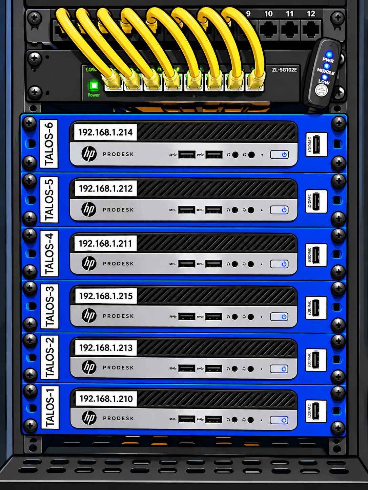
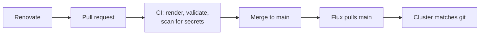

<div align="center">

# home-ops

_My home Kubernetes cluster, run as code:_
_[Talos Linux](https://www.talos.dev) on six mini PCs, deployed by [Flux](https://fluxcd.io), kept current by [Renovate](https://github.com/renovatebot/renovate)_

[](https://talos.dev)&nbsp;&nbsp; [](https://kubernetes.io)&nbsp;&nbsp; [](https://fluxcd.io)&nbsp;&nbsp;


[](https://github.com/home-operations/kromgo)&nbsp;&nbsp; [](https://github.com/home-operations/kromgo)&nbsp;&nbsp; [](https://github.com/home-operations/kromgo)&nbsp;&nbsp; [](https://github.com/home-operations/kromgo)&nbsp;&nbsp; [](https://github.com/home-operations/kromgo)&nbsp;&nbsp; [](https://github.com/home-operations/kromgo)&nbsp;&nbsp; [](https://github.com/home-operations/kromgo)

</div>

> [!NOTE]
> **Rebuilt in November 2026.** This repository replaces an earlier setup that was managed through
> a hosted control plane. The cluster was wiped and rebuilt from this repository, its backups were
> proven by deleting and restoring data, and the self-hosted apps below moved in from a single
> server.
>
> **Stage:** repository skeleton and tooling ✅ · Talos configs ✅ · bootstrap and core apps ✅ ·
> cluster rebuild ✅ · backups proven ✅ · apps migrated ✅ · public ✅

## Overview

This repository is the single source of truth for my home Kubernetes cluster. Everything from the
operating system configuration to the applications is declared here; nothing is configured by hand
on the nodes.

- **Infrastructure as code**: the Talos machine configuration for every node is rendered from the
  templates in [`talos/`](talos).
- **GitOps**: Flux watches the `main` branch and makes the cluster match
  [`kubernetes/`](kubernetes). A change is a pull request; merging it deploys it.
- **Automated updates**: Renovate opens pull requests for new versions of charts, images, tools,
  Talos and Kubernetes. CI renders and validates every pull request before it can merge.
- **No secrets in git**: not even encrypted ones. Secrets live in a secret manager and are pulled
  in at deploy time.

The layout and patterns follow [onedr0p/home-ops](https://github.com/onedr0p/home-ops) and the
[home-operations](https://github.com/home-operations) community.

## Hardware

Six **HP ProDesk 405 G4 Desktop Mini** PCs in a small rack, behind one managed gigabit switch.

<p align="center">
  
</p>

| Node            | Role               | CPU                                                              | RAM        | OS disk               | Data disk                    |
| --------------- | ------------------ | ---------------------------------------------------------------- | ---------- | --------------------- | ---------------------------- |
| `talos&#8209;1` | Control&nbsp;plane | AMD Ryzen 5 PRO 2400GE (4&nbsp;cores&nbsp;/&nbsp;8&nbsp;threads) | 32&nbsp;GB | 256&nbsp;GB&nbsp;NVMe | 1&nbsp;TB&nbsp;SATA&nbsp;SSD |
| `talos&#8209;2` | Control&nbsp;plane | AMD Ryzen 5 PRO 2400GE (4&nbsp;cores&nbsp;/&nbsp;8&nbsp;threads) | 32&nbsp;GB | 256&nbsp;GB&nbsp;NVMe | 1&nbsp;TB&nbsp;SATA&nbsp;SSD |
| `talos&#8209;3` | Control&nbsp;plane | AMD Ryzen 5 PRO 2400GE (4&nbsp;cores&nbsp;/&nbsp;8&nbsp;threads) | 32&nbsp;GB | 256&nbsp;GB&nbsp;NVMe | 1&nbsp;TB&nbsp;SATA&nbsp;SSD |
| `talos&#8209;4` | Worker             | AMD Ryzen 5 PRO 2400GE (4&nbsp;cores&nbsp;/&nbsp;8&nbsp;threads) | 32&nbsp;GB | 256&nbsp;GB&nbsp;NVMe | 1&nbsp;TB&nbsp;SATA&nbsp;SSD |
| `talos&#8209;5` | Worker             | AMD Ryzen 5 PRO 2400GE (4&nbsp;cores&nbsp;/&nbsp;8&nbsp;threads) | 32&nbsp;GB | 256&nbsp;GB&nbsp;NVMe | 1&nbsp;TB&nbsp;SATA&nbsp;SSD |
| `talos&#8209;6` | Worker             | AMD Ryzen 5 PRO 2400GE (4&nbsp;cores&nbsp;/&nbsp;8&nbsp;threads) | 32&nbsp;GB | 256&nbsp;GB&nbsp;NVMe | 1&nbsp;TB&nbsp;SATA&nbsp;SSD |

Supporting machines outside the cluster:

- **Unraid server**: S3 object storage (Garage), single sign-on (Authelia), media, photos and other
  self-hosted apps. Its Docker Compose stacks also live in Git (a private repository) and are
  deployed by [Komodo](https://komo.do): Renovate opens pull requests for new image versions, and
  merging one redeploys the stack through a GitHub webhook. A [Traefik](https://traefik.io) instance
  is the front door for those apps.
- **NAS**: the off-server backup target.
- **OPNsense router**: firewall, DNS and DHCP.
- **Raspberry Pi KVM**: console access to the nodes.
- **Raspberry Pi 5**: [Uptime Kuma](https://github.com/louislam/uptime-kuma) for uptime monitoring
  and alerting, kept independent of the rest.

## Components

| Area             | Tool                                                                                                                                                             |
| ---------------- | ---------------------------------------------------------------------------------------------------------------------------------------------------------------- |
| Operating system | [Talos Linux](https://www.talos.dev), configured from this repo with `talosctl`                                                                                  |
| GitOps           | [Flux](https://fluxcd.io) via the [Flux Operator](https://github.com/controlplaneio-fluxcd/flux-operator)                                                        |
| Networking       | [Cilium](https://cilium.io), [Envoy Gateway](https://gateway.envoyproxy.io), [cloudflared](https://github.com/cloudflare/cloudflared)                            |
| DNS              | [CoreDNS](https://coredns.io), [external-dns](https://github.com/kubernetes-sigs/external-dns)                                                                   |
| Certificates     | [cert-manager](https://cert-manager.io)                                                                                                                          |
| Secrets          | [External Secrets](https://external-secrets.io) with [Bitwarden Secrets Manager](https://bitwarden.com/products/secrets-manager)                                 |
| Storage          | [Longhorn](https://longhorn.io) (replicated block storage on the data disks)                                                                                     |
| Backups          | [Kopiur](https://github.com/home-operations/kopiur) ([Kopia](https://kopia.io)) to S3 and a NAS replica                                                          |
| Upgrades         | [tuppr](https://github.com/home-operations/tuppr) for Talos and Kubernetes; [Renovate](https://github.com/renovatebot/renovate) for everything                   |
| Observability    | [Prometheus](https://prometheus.io), [Grafana](https://grafana.com), [VictoriaLogs](https://docs.victoriametrics.com/victorialogs), [Vector](https://vector.dev) |
| Status badges    | [kromgo](https://github.com/home-operations/kromgo): the live badges at the top of this page                                                                     |

## Applications

Each application lives in `kubernetes/apps/<namespace>/<app>/`.

| Namespace          | Apps                                                                                                                                                                                                                                                                                                                                                                                                                                   |
| ------------------ | -------------------------------------------------------------------------------------------------------------------------------------------------------------------------------------------------------------------------------------------------------------------------------------------------------------------------------------------------------------------------------------------------------------------------------------- |
| `default`          | [Homepage](kubernetes/apps/default/homepage) (dashboard), [Trilium](kubernetes/apps/default/trilium) (notes), [Vaultwarden](kubernetes/apps/default/vaultwarden) (passwords), [website](kubernetes/apps/default/website) (jeffriffle.com), [fb-search](kubernetes/apps/default/fb-search), [Linkwarden](kubernetes/apps/default/linkwarden) (bookmarks, on CloudNativePG), [Atuin](kubernetes/apps/default/atuin) (shell history sync) |
| `headlamp`         | [Headlamp](kubernetes/apps/headlamp/headlamp) (Kubernetes web UI)                                                                                                                                                                                                                                                                                                                                                                      |
| `observability`    | [kube-prometheus-stack](kubernetes/apps/observability/kube-prometheus-stack), [Grafana](kubernetes/apps/observability/grafana-operator), [VictoriaLogs](kubernetes/apps/observability/victoria-logs), [Vector](kubernetes/apps/observability/vector), [kromgo](kubernetes/apps/observability/kromgo)                                                                                                                                   |
| `network`          | [Envoy Gateway](kubernetes/apps/network/envoy-gateway), [cloudflared](kubernetes/apps/network/cloudflare-tunnel), [external-dns](kubernetes/apps/network/cloudflare-dns), [k8s-gateway](kubernetes/apps/network/k8s-gateway)                                                                                                                                                                                                           |
| `longhorn-system`  | [Longhorn](kubernetes/apps/longhorn-system/longhorn)                                                                                                                                                                                                                                                                                                                                                                                   |
| `cnpg-system`      | [CloudNativePG](kubernetes/apps/cnpg-system/cloudnative-pg) (PostgreSQL operator), [Barman Cloud](kubernetes/apps/cnpg-system/barman-cloud) (database backups)                                                                                                                                                                                                                                                                         |
| `kopiur-system`    | [Kopiur](kubernetes/apps/kopiur-system/kopiur)                                                                                                                                                                                                                                                                                                                                                                                         |
| `system-upgrade`   | [tuppr](kubernetes/apps/system-upgrade/tuppr)                                                                                                                                                                                                                                                                                                                                                                                          |
| `external-secrets` | [External Secrets](kubernetes/apps/external-secrets/external-secrets) with the [Bitwarden store](kubernetes/apps/external-secrets/bitwarden)                                                                                                                                                                                                                                                                                           |
| `cert-manager`     | [cert-manager](kubernetes/apps/cert-manager/cert-manager)                                                                                                                                                                                                                                                                                                                                                                              |
| `flux-system`      | [Flux Operator](kubernetes/apps/flux-system/flux-operator), [Flux instance](kubernetes/apps/flux-system/flux-instance)                                                                                                                                                                                                                                                                                                                 |
| `kube-system`      | [Cilium](kubernetes/apps/kube-system/cilium), [CoreDNS](kubernetes/apps/kube-system/coredns), [metrics-server](kubernetes/apps/kube-system/metrics-server), [Reloader](kubernetes/apps/kube-system/reloader), [snapshot-controller](kubernetes/apps/kube-system/snapshot-controller), [Spegel](kubernetes/apps/kube-system/spegel)                                                                                                     |

## How a change reaches the cluster



1. A change (mine or Renovate's) is opened as a pull request.
2. CI renders every Flux resource and Helm release, validates the result, and scans the history
   for secrets. The `main` branch only accepts pull requests whose checks pass.
3. On merge, Flux applies the change. If a release fails, Flux reports it and alerts by email.

## Repository layout

```text
.
├── .github/workflows   CI: render and validate, secret scan, label sync
├── .mise               Pinned command-line tools and shared tasks (mise)
├── bootstrap           Takes freshly installed nodes to a Flux-managed cluster
├── kubernetes
│   ├── apps            One directory per namespace, one per application
│   └── components      Reusable pieces (alerts, backup and restore)
└── talos               Machine configuration templates for every node
```

## Secrets

Nothing secret is stored in this repository, encrypted or otherwise.

- **In the cluster**, applications declare an `ExternalSecret`; External Secrets fetches the value
  from Bitwarden Secrets Manager and creates the Kubernetes `Secret`.
- **On my laptop**, Talos configuration templates are rendered with
  [minijinja](https://github.com/mitsuhiko/minijinja) while `bws run` supplies the cluster's
  certificates and tokens as environment variables. Rendered configs are piped straight to
  `talosctl` and never written to disk.
- **In CI and before every commit**, [gitleaks](https://github.com/gitleaks/gitleaks) scans for
  anything that looks like a credential.
- **Details of the home network** that are not secrets but don't belong in public (the list of
  services outside the cluster, with LAN addresses) live in a private repository. Flux pulls just
  two folders from it as a second source: Homepage's service list, and the in-cluster names
  (`authelia`, `garage` in `network`) for Authelia and Garage on the Unraid server.

## Backups

Two independent tools write to two different machines, so a bug in one tool or the loss of one
machine cannot take out every copy.

| What                               | Tool                                                                            | Where                            | When                                      |
| ---------------------------------- | ------------------------------------------------------------------------------- | -------------------------------- | ----------------------------------------- |
| App data, file level               | [Kopiur](https://github.com/home-operations/kopiur) ([Kopia](https://kopia.io)) | S3 (Garage) on the Unraid server | hourly; 24 hourly, 7 daily, 4 weekly kept |
| Copy of the whole Kopia repository | Kopiur `RepositoryReplication`                                                  | NAS over NFS                     | nightly                                   |
| Volumes, block level               | Longhorn backups                                                                | NAS over NFS                     | nightly, 14 kept                          |

Each application's volume is declared with a Kopiur restore as its data source
([`components/kopiur`](kubernetes/components/kopiur)), so on a rebuilt cluster the application comes
back with its data without any manual steps; a brand-new app simply starts empty. All three paths
were tested by writing known data, deleting the volume and restoring it: the restored files were
identical.

## Tooling

Tools are pinned in [`.mise/config.toml`](.mise/config.toml) and installed with
[mise](https://mise.jdx.dev):

```sh
mise trust && mise install
mise tasks --all    # list the available tasks
```

Tasks live next to what they act on (`bootstrap/`, `kubernetes/`, `talos/`) and are named by
directory, so run them from anywhere in the repository with the full name, for example
`mise run //talos:apply-node talos-1`. Plain `mise tasks` lists only the current directory's tasks:
empty at the root, or that directory's tasks inside one of those folders.

## Thanks

To [onedr0p](https://github.com/onedr0p) and the
[home-operations](https://github.com/home-operations) community, whose repositories and tools this
one is built on. For more examples of clusters like this, see
[kubesearch.dev](https://kubesearch.dev).
