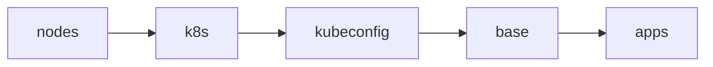

# Bootstrap

Everything needed to take freshly installed Talos nodes to a cluster that Flux manages on its own.
The entire process is driven by a single command:

```sh
mise run //bootstrap:cluster
```

Once it completes, Flux reconciles the rest of the repository and this directory is not used again
until the next rebuild.

## Prerequisites

- The tools pinned in [`.mise/config.toml`](../.mise/config.toml) (`mise install`).
- A Bitwarden Secrets Manager access token in `~/.config/bws/access-token` (or `BWS_ACCESS_TOKEN`).
  Machine secrets never live in this repo; every `{{ ENV.NAME }}` reference in the Talos configs
  and bootstrap manifests is resolved at apply time by `bws run`.
- A valid `talosconfig` at the repo root (`mise run //talos:talosconfig`). The bootstrap tasks
  derive the controller endpoint and node list from `talosctl config info`, so nothing is hardcoded
  here.
- Nodes booted from the Talos install image and waiting in maintenance mode.

## Stages

`mise run //bootstrap:cluster` runs these stages in order (see [mise.toml](mise.toml)):



1. **nodes** - Renders each node's Talos config (`talos/*.j2` templates plus secrets from
   Bitwarden) and applies it with `talosctl apply-config --insecure`. Nodes that are already
   configured are skipped, so the stage is idempotent.
2. **k8s** - Runs `talosctl bootstrap` against the controller, retrying until etcd reports the
   cluster already exists.
3. **kubeconfig** - Fetches the kubeconfig with `talosctl kubeconfig`.
4. **base** - Waits for every control plane apiserver to answer `/readyz` and for nodes to register
   (they stay `Ready=False` until the CNI is installed), then applies:
    - `kustomize/` - the two Secrets that must exist before anything can fetch a secret, plus their
      namespaces: the Bitwarden access token for External Secrets and the deploy key Flux uses to
      pull this repository. These exist before their controllers so nothing deadlocks on a missing
      Secret.
    - `helmfile/crds.yaml` - CRDs extracted from upstream charts and applied directly. Installing
      CRDs out-of-band means Flux Kustomizations that consume CRD-backed resources don't need
      `dependsOn` chains.
5. **apps** - `helmfile sync` of `helmfile/apps.yaml`, the minimal release chain Flux needs before
   it can take over:

    cilium → coredns → spegel → cert-manager → external-secrets → flux-operator → flux-instance

    Two hooks cover the Bitwarden specifics: after cert-manager is up, the certificate for the
    Bitwarden SDK server is requested (the server cannot start without it), and after
    external-secrets is up, the `ClusterSecretStore` is applied.

    Once `flux-instance` is healthy, Flux reconciles `kubernetes/` and manages these same releases
    from then on.

> [!TIP]
> Every stage is safe to re-run. If bootstrap fails partway, fix the issue and run
> `mise run //bootstrap:cluster` again.

## Data restore (Kopiur)

Bootstrap itself restores no application data; that happens declaratively once Flux takes over,
via [Kopiur](https://github.com/home-operations/kopiur).

Apps that opt into the `kopiur/backup` component get a PVC whose `spec.dataSourceRef` points at a
Kopiur `Restore`. When Flux applies the app on a fresh cluster, the PVC is provisioned by restoring
the latest snapshot from the backup repository. The pod simply stays `Pending` until the data is
back; no ordering logic is needed anywhere. An app with no snapshot yet comes up with an empty
volume, so the same manifests handle first deploy and disaster recovery.

## Single source of truth

The helmfiles define no chart versions or values of their own. Each release's chart and version
are read from the app's `ocirepository.yaml` and its values from the app's `helmrelease.yaml` under
`kubernetes/apps/` (see [helmfile/templates/](helmfile/templates/)). Bootstrap therefore installs
exactly what Flux will later reconcile, and Renovate updates only one place.
